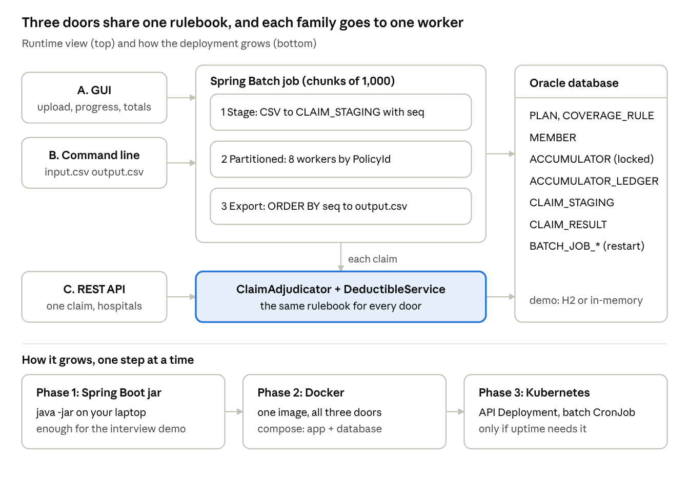

# Claims Processing System

Adjudicates health-insurance claims for ABC Health Insurance (fictitious) plans P001–P003:
for each claim it decides **how much the member pays and how much the plan pays**, using
individual and family annual deductibles and three coverage-rule types.

> TODO (you): one sentence on the result, e.g. "All 19 sample transactions match the expected output."

## Three ways to run it

| Mode | Command / URL |
| --- | --- |
| A. GUI | `java -jar target/claims.jar` → open http://localhost:8080 |
| B. Batch (CLI) | `java -jar target/claims.jar input.csv output.csv` |
| C. REST API | `curl -X POST http://localhost:8080/api/v1/claims/adjudicate -H "Content-Type: application/json" -d @claim.json` (TODO: add a sample claim.json) |
| Deductible service | `POST /api/v1/deductible/status` |

TODO (you): build command, Java version (21), Docker command once Phase 2 is done.

## The three decisions that matter most

1. **Deductible status is checked before each claim; a claim is never split** ([ADR 0002](docs/adr/0002-check-deductible-before-claim-no-split.md)).
2. **The member's share always adds to both accumulators**, even after the deductible is met ([assumption A3](docs/02-assumptions.md)).
3. **The percentage is the plan's share**, the opposite of usual US "coinsurance" wording ([ADR 0001](docs/adr/0001-plan-percent-is-plan-share.md)).

## Architecture at a glance

One domain core (plain Java, no Spring) is shared by all three doors. Spring Batch drives file
processing; the REST API calls the core directly. See [docs/03-design.md](docs/03-design.md).

## Documentation

| Document | What it covers |
| --- | --- |
| [01 Problem and glossary](docs/01-problem-and-glossary.md) | Business terms, rules, worked scenarios |
| [02 Assumptions](docs/02-assumptions.md) | Every gap in the spec, the decision taken, and the test that proves it |
| [03 Design](docs/03-design.md) | Classes, packages, flow of one claim |
| [04 Scaling and deployment](docs/04-scaling-and-deployment.md) | 700,000 claims/day, Spring Batch, Docker, Kubernetes |
| [05 Testing](docs/05-testing.md) | Test strategy, sample regression, extra cases |
| [ADRs](docs/adr/) | One page per key decision |
| [Dev log](docs/dev-log.md) | Dated journal: work done, hours, tools (incl. AI), problems |

## Tech stack

Java 21 · Spring Boot 4.x · Spring Batch (JDBC job repository) · H2 (demo) · JUnit 5 · Maven

TODO (you): add anything else you end up using (springdoc, Testcontainers, Docker).
