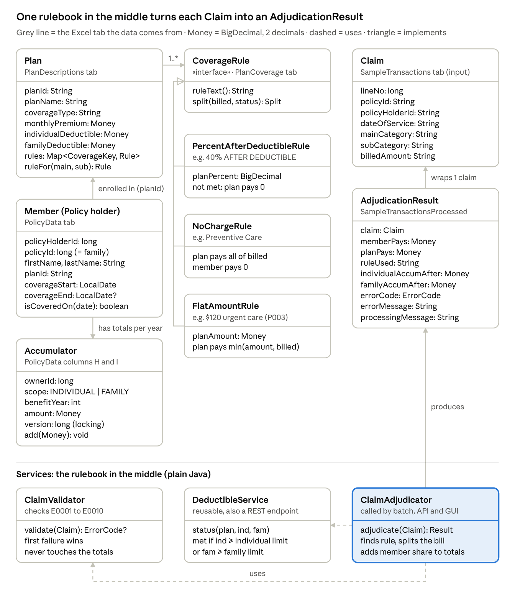

# 03 · Design

## Principles

- **The core has no Spring dependency** (ADR 0005): `domain` and `service` are plain Java, unit-testable in milliseconds.
- **One rulebook, three modes**: GUI, CLI and REST all call the same `ClaimAdjudicator`.
- **Errors are results, not exceptions**: an invalid claim becomes an output row with an error code, so it keeps its position (A12).
- **Fail fast on reference data**: a bad plan, rule or policy row stops start-up instead of producing wrong payments.

## Class diagram



Source: [diagrams/class-diagram.mmd](diagrams/class-diagram.mmd)

## Packages

```text
com.claims
  domain     Plan, Member, CoverageKey, CoverageRule (+ PercentAfterDeductibleRule, NoChargeRule,
             FlatAmountRule), DeductibleStatus, Split, Accumulator, Claim, AdjudicationResult, ErrorCode, Money
  service    ClaimValidator, ValidationOutcome, DeductibleService, ClaimAdjudicator,
             AccumulatorStore (port) + InMemoryAccumulatorStore, PlanRepository / MemberRepository (ports)
  refdata    CsvLine, ReferenceDataLoader, ReferenceData (implements both repository ports)
  config     ClaimsProperties (claims.*), ClaimsConfiguration (wires the plain-Java core as beans)
  batch      ClaimJobConfig, ClaimLineMapper, ClaimItemProcessor, ResultCsvFormatter,
             JobRunService, RunRegistry, RunStats, RunProgressListener
  cli        BatchCommandLineRunner
  api        ClaimController, DeductibleController, request/response records, ApiExceptionHandler
  web        JobController (GUI backend); the page itself is src/main/resources/static/index.html
```

Dependencies point inwards: `api`, `web`, `cli`, `batch`, `config` → `service` → `domain`. `refdata` implements the
`service` ports. Nothing in `domain` or `service` imports Spring.

## The three modes

| Mode | Entry point | Path through the code |
| --- | --- | --- |
| A. GUI | `index.html` → `POST /api/v1/jobs` | `JobController` → `JobRunService.start` (background thread) → Spring Batch job; page polls `GET /api/v1/jobs/{runId}` |
| B. CLI | `java -jar claims.jar in.csv out.csv` | `main()` starts without a web server → `BatchCommandLineRunner` → `JobRunService.runAndWait` → same job; prints a summary, sets the exit code |
| C. REST | `POST /api/v1/claims/adjudicate` | `ClaimController` → `ClaimAdjudicator` with a throwaway accumulator store seeded from the request |

## The Spring Batch job

```text
claimJob
└── adjudicateClaims (chunk-oriented step, chunk size = claims.chunk-size, single thread)
    ├── reader     FlatFileItemReader<Claim>  + ClaimLineMapper   (raw strings, header skipped)
    ├── processor  ClaimItemProcessor → ClaimAdjudicator          (never returns null, never throws)
    ├── writer     FlatFileItemWriter<AdjudicationResult> + ResultCsvFormatter (header, LF line endings)
    └── listener   RunProgressListener → RunStats                (live totals for GUI/CLI)
```

- Reader, processor, writer and listener are **step-scoped**: each run gets its own file paths and its own
  accumulator store seeded from PolicyData (ADR 0007).
- Job parameters: `inputFile`, `outputFile`, `runId` (unique per run, so a file can be processed again).
- Job metadata (`BATCH_*` tables) is stored in in-memory H2 for the demo (ADR 0004).
- Built on **Spring Batch 6** APIs: `JobOperator.start(job, params)`, `StepBuilder.chunk(size).transactionManager(tm)`,
  `org.springframework.batch.infrastructure.item.*` (see dev-log issue 9).

## Flow of one claim (sample row 14)

1. `ClaimLineMapper` builds `Claim` (raw strings, lineNo 14).
2. `ClaimValidator` parses and checks it in the documented order → `Valid` (member 1000012, plan P001, rule `PercentAfterDeductibleRule(60)`).
3. `DeductibleService.status(P001, 467.60, 12000.00)` → individual not met, family met.
4. Rule splits $240.60: plan 144.36, member 96.24.
5. `AccumulatorStore.add` → 563.84 / 12,096.24.
6. `ResultCsvFormatter` writes the row; `RunProgressListener` adds it to the run totals.

## REST error mapping

| Situation | HTTP | Body |
| --- | --- | --- |
| Claim processed | 200 | `ClaimResponse` |
| Claim rejected by a business rule (E0001–E0010) | 422 | `ClaimResponse` with `errorCode`, `errorMessage` |
| Missing accumulators, malformed JSON | 400 | RFC 9457 problem detail |
| Unknown plan on the deductible endpoint | 404 | problem detail |
| Unexpected failure inside adjudication | 500 | `ClaimResponse` with E0099; logged with line number only (no PHI in logs) |

## Design patterns used

| Pattern | Where | Why |
| --- | --- | --- |
| Strategy | `CoverageRule` implementations | New rule type = new class, no if/else chain |
| Sealed hierarchy | `CoverageRule`, `ValidationOutcome` | Compiler checks every case is handled (`switch` in `ClaimAdjudicator`) |
| Ports and adapters | `PlanRepository`, `MemberRepository`, `AccumulatorStore` | Swap CSV / memory for Oracle without touching the core |
| Factory method | `CoverageRule.parse()` | Rule text → rule object in one place |
| Result object | `AdjudicationResult.error(...)` | Errors flow through the pipeline like normal rows |
